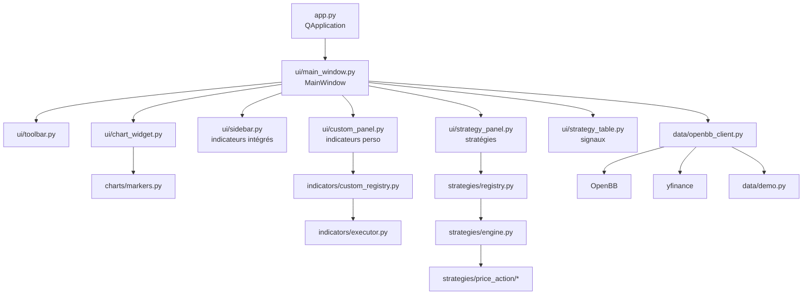

# Architecture

## Vue d'ensemble



## Organisation des dossiers

```text
trading-matrix/
├── app.py                    # Point d'entrée
├── requirements.txt
├── core/
│   ├── config.py             # Constantes, palette, intervalles/périodes
│   ├── ollama_client.py      # Statut Ollama, modèles, chat en streaming
│   └── signal_context.py     # Contexte de marché + prompt d'analyse IA
├── data/
│   ├── openbb_client.py      # Chargement OHLCV (OpenBB → yfinance → démo)
│   └── demo.py               # Générateur de données synthétiques
├── charts/
│   └── markers.py            # Dessin des signaux (flèches, zones, SL/TP)
├── indicators/
│   ├── manager.py            # SMA, EMA, RSI, MACD, Bollinger
│   ├── base.py               # PlotItem, IndicatorResult
│   ├── executor.py           # Chargement des modules perso
│   └── custom_registry.py    # Registre des indicateurs perso
├── strategies/
│   ├── base.py               # Side, Signal, StrategyContext, BaseStrategy
│   ├── utils.py              # ATR, patterns élémentaires
│   ├── registry.py           # Registre built-in + perso
│   ├── engine.py             # Exécution + filtrage des signaux
│   ├── price_action/
│   │   ├── structure.py      # Swings, tendance, BOS/CHOCH
│   │   ├── patterns.py       # Réactions price action
│   │   ├── zones.py          # Order Blocks
│   │   └── general.py        # Stratégie Price Action Général
│   └── user_strategies/      # Stratégies personnalisées
├── ui/
│   ├── main_window.py        # Fenêtre principale + docks
│   ├── toolbar.py            # Symbole / intervalle / période
│   ├── chart_widget.py       # Chandeliers, volume, crosshair, sous-graphiques
│   ├── sidebar.py            # Panneau indicateurs intégrés
│   ├── custom_panel.py       # Panneau indicateurs perso
│   ├── indicator_editor.py   # Éditeur de code intégré
│   ├── strategy_panel.py     # Panneau stratégies + filtres
│   ├── strategy_table.py     # Tableau des signaux + bouton d'analyse IA
│   ├── ai_analysis_dialog.py # Fenêtre d'analyse IA (Ollama, streaming)
│   └── styles.qss            # Thème sombre
├── user_indicators/          # Indicateurs personnalisés
├── utils/helpers.py          # Helpers de conversion
├── doc/                      # Cette documentation
└── assets/icons/
```

## Flux de données

### Chargement des données

```text
Toolbar.loadRequested(symbol, interval, period)
   └─> MainWindow.load_data()
         └─> OpenBBClient.get_ohlcv()
               ├─ 1. OpenBB (provider yfinance)
               ├─ 2. yfinance direct
               └─ 3. generate_demo()
         └─> ChartWidget.set_data(df)
         └─> réapplication des indicateurs actifs
```

Le DataFrame retourné est normalisé :

- index `DatetimeIndex` nommé `Date`
- colonnes `Open`, `High`, `Low`, `Close`, `Volume` (+ `Adj Close` si présent)
- lignes incomplètes supprimées (`dropna`)

### Indicateurs

```text
IndicatorPanel.indicatorsChanged(cfg)
   └─> MainWindow.apply_indicators(cfg)
         └─> IndicatorManager.sma/ema/rsi/macd/bollinger()
         └─> ChartWidget.add_overlay() / add_bollinger() / add_subplot()
```

### Stratégies

```text
StrategyPanel.analyzeRequested(id, params, filters)
   └─> MainWindow.run_strategy()
         └─> StrategyEngine.run()
               └─> StrategyRegistry.get(id).instance.analyze(ctx)
               └─> filtrage (confiance, R:R, sens, max)
         └─> SignalTable.set_signals(signals)
         └─> charts.markers.draw_signals(chart, signals)
```

### Indicateurs personnalisés

```text
CustomIndicatorPanel.applyCustom(id, params)
   └─> MainWindow.apply_custom_indicator()
         └─> CustomRegistry.compute(id, df, params)
               └─> importlib charge user_indicators/<id>.py
               └─> mod.compute(df, **params) -> IndicatorResult | dict
         └─> ChartWidget (overlay ou subplot)
```

## Conventions

- **Coordonnées X** des graphiques : index ordinal de la bougie (`0..n-1`),
  pas le timestamp. La conversion en date est faite au survol.
- **Aucune donnée globale mutable** : le `DataFrame` courant est stocké dans
  `MainWindow.current_df`.
- **Séparation UI / logique** : les calculs (indicateurs, stratégies) sont
  indépendants de Qt et testables en dehors de l'interface.
- **Extensibilité** : les dossiers `user_indicators/` et
  `strategies/user_strategies/` sont scannés dynamiquement.

## Threads et performances

Les calculs sont effectués **sur le thread principal** (UI). Pour des jeux de
données de quelques centaines à quelques milliers de bougies, cela reste fluide.
Pour des volumes plus importants, il faudra déporter l'analyse dans un
`QThread` / `QRunnable`.

La stratégie Price Action recalcule sa structure tous les 5 bougies sur une
fenêtre tronquée (`df.iloc[:i+1]`) afin d'éviter le *lookahead bias* et de
limiter le coût de calcul.
