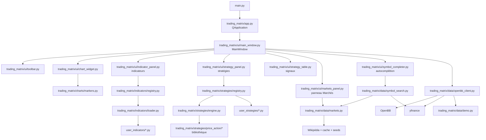

# Architecture

## Vue d'ensemble



## Organisation des dossiers

```text
trading-matrix/
├── main.py                     # Point d'entrée (python main.py)
├── requirements.txt
├── trading_matrix/             # Package de l'application
│   ├── __init__.py
│   ├── app.py                  # Création de QApplication + MainWindow
│   ├── core/
│   │   ├── config.py           # Constantes, palette, chemins, intervalles/périodes
│   │   ├── ollama_client.py    # Statut Ollama, modèles, chat en streaming
│   │   └── signal_context.py   # Contexte de marché + prompt d'analyse IA
│   ├── data/
│   │   ├── openbb_client.py    # Chargement OHLCV (OpenBB → yfinance → démo)
│   │   ├── markets.py          # Marchés, parsing Wikipédia, cache, seeds
│   │   ├── market_seeds.json   # Instantané embarqué des indices (hors ligne)
│   │   ├── symbol_search.py    # Recherche d'actifs (yfinance + repli local)
│   │   └── demo.py             # Générateur de données synthétiques
│   ├── charts/
│   │   └── markers.py          # Dessin des signaux (flèches, zones, SL/TP)
│   ├── indicators/
│   │   ├── base.py             # PlotItem, IndicatorResult, ParamSpec, normalize_params
│   │   ├── loader.py           # Chargement des modules d'indicateurs
│   │   └── registry.py         # Registre des indicateurs (IndicatorRegistry)
│   ├── strategies/
│   │   ├── base.py             # Side, Signal, StrategyContext, BaseStrategy
│   │   ├── utils.py            # ATR, patterns élémentaires
│   │   ├── registry.py         # Registre des stratégies (user_strategies/)
│   │   ├── engine.py           # Exécution + filtrage des signaux
│   │   └── price_action/       # Bibliothèque price action réutilisable
│   │       ├── structure.py    # Swings, tendance, BOS/CHOCH
│   │       ├── patterns.py     # Réactions price action
│   │       └── zones.py        # Order Blocks
│   ├── ui/
│   │   ├── main_window.py      # Fenêtre principale + docks
│   │   ├── toolbar.py          # Symbole / intervalle / période
│   │   ├── chart_widget.py     # Chandeliers, volume, crosshair, sous-graphiques
│   │   ├── indicator_panel.py  # Panneau unique des indicateurs (user_indicators/)
│   │   ├── indicator_editor.py # Éditeur de code intégré
│   │   ├── strategy_panel.py   # Panneau stratégies + filtres
│   │   ├── strategy_table.py   # Tableau des signaux + bouton d'analyse IA
│   │   ├── markets_panel.py    # Panneau Marchés (indices, filtre, tri)
│   │   ├── symbol_completer.py # Autocomplétion du champ Symbole
│   │   ├── ai_analysis_dialog.py # Fenêtre d'analyse IA (Ollama, streaming)
│   │   └── styles.qss          # Thème sombre
│   └── utils/helpers.py        # Helpers de conversion
├── tests/                      # Tests pytest (réseau simulé)
│   ├── fixtures/               # Pages HTML figées
│   ├── test_markets.py
│   └── test_symbol_search.py
├── pytest.ini                  # Configuration pytest (pythonpath)
├── user_indicators/            # Tous les indicateurs (défaut + perso)
├── user_strategies/            # Toutes les stratégies (défaut + perso)
├── doc/                        # Cette documentation
└── assets/icons/
```

## Flux de données

### Chargement des données

```text
Toolbar.loadRequested(symbol, interval, period)
   └─> MainWindow.load_data()
         └─> OpenBBClient.get_ohlcv()
               ├─ 1. OpenBB (provider yfinance)
               ├─ 2. yfinance direct
               └─ 3. generate_demo()
         └─> ChartWidget.set_data(df)
         └─> réapplication des indicateurs actifs
```

Le DataFrame retourné est normalisé :

- index `DatetimeIndex` nommé `Date`
- colonnes `Open`, `High`, `Low`, `Close`, `Volume` (+ `Adj Close` si présent)
- lignes incomplètes supprimées (`dropna`)

### Autocomplétion du symbole

```text
SymbolCompleter (champ Symbole)
   └─ délai 300 ms après la dernière frappe
        └─ _SearchThread (QThread)
             └─ symbol_search.search_symbols()
                  ├─ yfinance.Search (réseau)
                  └─ markets.search_local() (repli seeds + cache)
   └─ résultats -> QListWidget flottant (symbole + nom + place)
   └─ Entrée / double-clic -> Toolbar.request_load(symbol)
        └─ Toolbar.loadRequested -> MainWindow.load_data()
```

Un compteur de génération ignore les réponses arrivées après une frappe plus
récente. Le champ ne reçoit que le symbole, jamais le libellé affiché.

### Panneau Marchés

```text
MarketsPanel.reload()
   └─ _MarketThread (QThread)
        └─ markets.fetch_market(market_id, force)
             ├─ 1. cache disque frais (< 7 jours)
             ├─ 2. Wikipédia (requests + pandas.read_html)
             ├─ 3. cache périmé
             └─ 4. market_seeds.json (embarqué)
   └─ tableau triable + statut (Réseau / Cache / Hors ligne)
   └─ double-clic -> Toolbar.request_load(symbol)
```

### Indicateurs

```text
IndicatorPanel.indicatorsChanged([(id, params), ...])
   └─> MainWindow.apply_indicators(selection)
         └─> IndicatorRegistry.compute(id, df, params)
               └─> importlib charge user_indicators/<id>.py
               └─> mod.compute(df, **params) -> IndicatorResult | dict
         └─> ChartWidget.add_overlay() / add_subplot()
```

### Stratégies

```text
StrategyPanel.analyzeRequested(id, params, filters)
   └─> MainWindow.run_strategy()
         └─> StrategyEngine.run()
               └─> StrategyRegistry.get(id).instance.analyze(ctx)
               └─> filtrage (confiance, R:R, sens, max)
         └─> SignalTable.set_signals(signals)
         └─> charts.markers.draw_signals(chart, signals)
```

## Conventions

- **Coordonnées X** des graphiques : index ordinal de la bougie (`0..n-1`),
  pas le timestamp. La conversion en date est faite au survol.
- **Aucune donnée globale mutable** : le `DataFrame` courant est stocké dans
  `MainWindow.current_df`.
- **Séparation UI / logique** : les calculs (indicateurs, stratégies) sont
  indépendants de Qt et testables en dehors de l'interface.
- **Extensibilité** : les dossiers `user_indicators/` et
  `user_strategies/` sont scannés dynamiquement. Le cœur du logiciel ne
  contient aucune définition d'indicateur ni de stratégie.

## Threads et performances

Les calculs d'indicateurs et de stratégies sont effectués **sur le thread
principal** (UI). Pour des jeux de données de quelques centaines à quelques
milliers de bougies, cela reste fluide.

Deux accès réseau sont déportés dans des `QThread` pour ne pas geler
l'interface :

- l'autocomplétion (`symbol_completer.py`) ;
- le chargement des marchés (`markets_panel.py`).

Les deux utilisent un compteur de génération : une réponse devenue obsolète
(frappe ou marché changé entre-temps) est ignorée. À la fermeture, les threads
sont interrompus et attendus (`shutdown()`).

La stratégie Price Action recalcule sa structure tous les 5 bougies sur une
fenêtre tronquée (`df.iloc[:i+1]`) afin d'éviter le *lookahead bias* et de
limiter le coût de calcul.

## Tests

Les tests couvrent la couche données, sans accès réseau : `yfinance.Search` est
simulé et le parsing s'appuie sur des pages HTML figées dans
`tests/fixtures/`.

```bash
pip install pytest   # outil de développement, absent de requirements.txt
python -m pytest
```

`pytest.ini` déclare `testpaths = tests` et ajoute la racine du dépôt au
`pythonpath`. Cas couverts : normalisation des suffixes, détection de table,
TTL/cache/seeds, classement par place de cotation, dédoublonnage et repli local.
